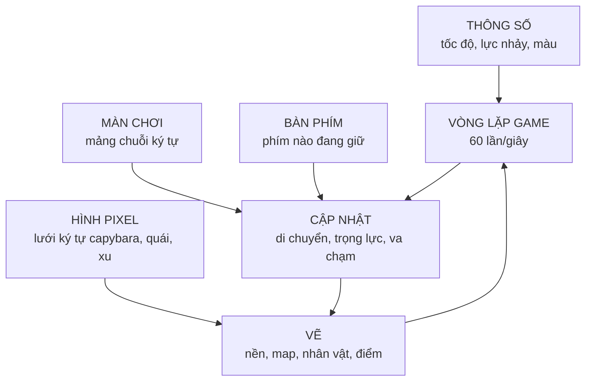

# Game platformer Capybara mắt lé

## Overview

Làm game platformer 2D trong một file index.html bằng JavaScript thuần, qua 5 bước nhỏ, cho người chưa từng lập trình. Nhân vật chính là một con capybara pixel 8-bit ngộ nghĩnh, mắt lé. Cách chơi giống thể loại Mario: chạy, nhảy, ăn xu, húc khối, đạp quái, chạm cờ đích. Mọi nhân vật và hình ảnh đều tự thiết kế.

Nguồn quyết định: [báo cáo brainstorm](../reports/brainstorm-261107-2206-platformer-hoc-lap-trinh.md).

## Outcome

Bấm đúp `index.html` là chơi được một màn hoàn chỉnh từ đầu tới cờ. Người dùng tự giải thích được vòng lặp game, trọng lực và va chạm, và tự sửa được thông số.

## Constraints

- Chỉ một file: `/Users/truongbaodi/Downloads/CLAUDE APP/game mario/index.html`. Không thư viện ngoài, không công cụ build, không cần server.
- Chú thích và giải thích bằng tiếng Việt, viết cho người chưa từng code.
- Sau mỗi giai đoạn, game mở được và chạy không lỗi.
- Nhân vật capybara và quái tự thiết kế, vẽ từ lưới ký tự. Không dùng bất kỳ tài sản nào của Nintendo.
- Các thông số chỉnh được (tốc độ, lực nhảy, trọng lực, bảng màu) gom ở đầu phần script.

## Non-goals

Điện thoại, âm thanh, nhiều màn, power-up, lưu điểm cao, framework.

## Phases

| # | Phase | Kết quả người dùng thấy | Effort | Status |
|---|-------|-------------------------|--------|--------|
| 1 | [Cài đặt và vẽ capybara](./phase-01-cai-dat-va-ve-capybara.md) | Capybara pixel đứng trên nền trời | 1h | Completed |
| 2 | [Di chuyển bằng bàn phím](./phase-02-di-chuyen-ban-phim.md) | Bấm ← → thì capybara chạy, chân nhún | 45m | Completed |
| 3 | [Trọng lực, nhảy và va chạm](./phase-03-trong-luc-nhay-va-cham.md) | Nhảy, rơi, đứng trên đất và bục | 1h15m | Completed |
| 4 | [Màn chơi, camera, xu và cờ](./phase-04-man-choi-camera-xu-co.md) | Màn dài cuộn ngang, ăn xu, húc khối, cờ đích | 1h | Completed |
| 5 | [Quái và thắng/thua](./phase-05-quai-thang-thua.md) | Quái đi qua lại, thắng, thua, chơi lại | 1h | Completed |

Các giai đoạn phải làm **tuần tự**, vì giai đoạn sau sửa tiếp chính file của giai đoạn trước.

## Kiến trúc trong file `index.html`



Thứ tự các phần trong file từ trên xuống: thông số, hình pixel, màn chơi, bàn phím, các hàm cập nhật, các hàm vẽ, vòng lặp game. Người mới đọc từ trên xuống là theo được.

## Success Criteria

- [ ] Bấm đúp `index.html` là game chạy trên Safari và Chrome, Console không có lỗi đỏ.
- [x] Capybara mắt lé chạy bằng ← →, nhảy bằng Space, đứng được trên đất và bục.
- [x] Màn chơi dài hơn một màn hình, camera cuộn theo.
- [x] Ăn xu thì tăng điểm; húc khối từ dưới lên thì nhả xu, mỗi khối một lần.
- [x] Đạp đầu quái thì quái biến mất; chạm hông quái hoặc rơi xuống hố thì chơi lại.
- [x] Chạm cờ thì hiện "Thắng!".
- [ ] Mỗi giai đoạn có phần giải thích tiếng Việt; người dùng sửa được 3 thông số và thấy game đổi theo.

## Risks

| Rủi ro | Cách giảm |
|---|---|
| Giai đoạn 3 quá khó với người mới | Giải thích bằng hình chữ nhật chồng nhau; cho thử đổi số trọng lực |
| Nhảy cao thấp khác nhau trên màn 60Hz và 120Hz | Bước cập nhật cố định 1/60 giây ngay từ giai đoạn 2 |
| Rơi xuyên đất khi rơi nhanh | Giới hạn tốc độ rơi nhỏ hơn kích thước một ô |
| Phạm vi phình ra | Giữ đúng Non-goals đến hết giai đoạn 5 |

## Next step

```bash
/ak-cook plans/261107-1513-capybara-platformer/plan.md
```

<!-- slug: capybara-platformer -->
